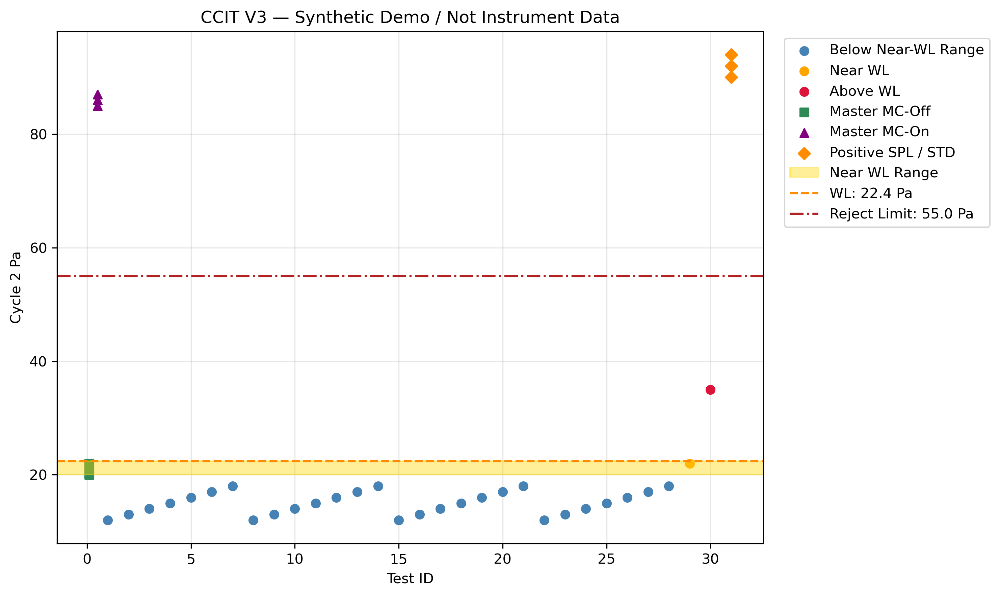
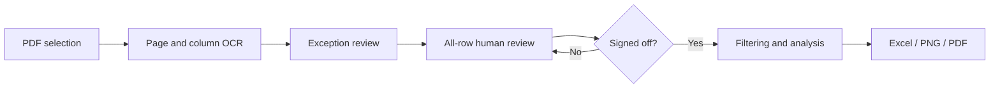

# Container Closure Integrity Testing (CCIT) / Vacuum Decay Review & Analysis

**From scanned test reports to reviewed data, analysis and charts.**

[繁體中文](README.zh-TW.md) · [Design notes / 設計說明](docs/DESIGN.md) · [Operation guide / 操作指南](docs/USAGE.md)

A Python portfolio project inspired by the practical laboratory task of manually transferring container closure integrity testing (CCIT) results from instrument PDF reports into Excel. It combines template-based PDF OCR, column alignment, exception review and a final human review and sign-off step before generating statistical analyses, Excel reports and charts. The public repository contains only synthetic demonstration data. This project is a development prototype and has not undergone formal computerized system validation for GMP use.

**Status:** local desktop prototype. Not a validated production system or an authenticated electronic-signature solution.



*The chart above is generated from fictional data. It demonstrates analysis and visualization, not OCR accuracy or a validated acceptance criterion.*

## The problem

Instrument reports may arrive as PDFs or scans. Transferring selected measurements into Excel takes time, and OCR can introduce errors that still look plausible. A value of `18` read as `19` may pass a numeric-format check.

This project separates **extraction**, **human verification** and **analysis** so that a successful OCR run is not mistaken for verified data.

## What it does

- Select a PDF without renaming it or copying the application.
- Render pages and extract text, bounding boxes and recognition scores.
- Locate expected headers, crop measurement columns and match rows by page coordinates.
- Flag recognized exceptions and retain manually entered correction reasons.
- Require every row—including proposed exclusions—to be confirmed in a final review workbook.
- Record the reviewer name, review date and source fingerprint before downstream analysis.
- Apply a configurable-by-code analysis workflow and produce formatted Excel, PNG and PDF outputs.
- Keep separate work folders for different PDF contents and liquid/solid settings.



## Quick start

Developed locally with **Windows and Python 3.13**. Other platforms and fresh installations have not yet been verified. The application currently prints Traditional Chinese progress/review messages; the documentation and report headings are bilingual/English.

```powershell
python -m venv .venv
.\.venv\Scripts\python.exe -m pip install -r requirements.txt
.\.venv\Scripts\python.exe run_ccit_v3.py
```

Choose a compatible PDF, then enter `liquid` or `solid`. For command-line use:

```powershell
.\.venv\Scripts\python.exe run_ccit_v3.py --pdf "C:\reports\test-report.pdf" --product-type liquid
```

The file picker uses Tkinter. OCR models may be downloaded by RapidOCR on first use; model weights are not included in this repository. Processing runs on the local machine; this application does not intentionally upload source reports.

## Try the synthetic demo

No instrument report or OCR model is needed for the demo:

```powershell
python -m pip install -r requirements-demo.txt
python demo.py
python -m unittest discover -s tests -v
```

The demo generates a fixed fictional dataset, exercises filtering, calculation, Excel formatting and chart export, and writes to `demo_output/`. It deliberately **does not exercise OCR or represent human approval**. It cannot accept a real input file.

The synthetic fixture has 51 records: 10 trailing suitability records and 2 QC checks are excluded, leaving 39 records (30 ordinary samples, 3 positive controls and 6 masters).

## Human review is part of the workflow

1. Resolve any exception CSVs using the page images.
2. Open `CCIT_final_review.xlsx` in the current work folder.
3. In **Data Review**, compare every row with its **Source Image** and select `Yes` in **Confirmed**.
4. In **Sign-off**, enter reviewer name, date and `Approved`.
5. Save, close Excel and run the same PDF with the same product type again.

Unconfirmed rows stop the main pipeline. Changed source data requires a new review and archives the earlier workbook. The final review sheet is for comparison/sign-off, **not direct measurement editing**; corrections belong in the upstream review process. An error outside existing correction handlers needs a handler/code change before continuation.

Sign-off records are plain local records with hashes. They do not authenticate the reviewer and are not tamper-proof. Individual scripts can be run separately; the main entry point is the supported workflow.

## Analysis rules demonstrated

| Step | Current implementation |
|---|---|
| Filtering | Exclude the final 10 records across the report, then `QC Check` records |
| Categories | Master MC-Off, Master MC-On, STD/Positive SPL, ordinary SPL |
| X positions | Masters: 0.1 and 0.5; samples: 1…N; positives: N+1 |
| Preliminary reference filter | Upper threshold = median + 3 × 1.4826 × MAD |
| Reference statistics | Mean and sample SD of ordinary samples not excluded by that filter |
| Near WL | Mean + 2 SD through Mean + 3 SD, inclusive |
| Above WL | Greater than Mean + 3 SD |
| Reject limit | Midpoint of positive-control mean and WL, followed by the documented rounding rule |
| System settings | Separate liquid/solid presets |

Samples excluded from reference statistics remain visible in the analysis and chart. Instrument Pass/Fail and statistical WL status are separate fields. These are project-specific demonstration rules, not generally established CCIT requirements. See [design notes](docs/DESIGN.md) for exact boundaries and limitations.

## Project layout

```text
run_ccit_v3.py       PDF selection, work folders, pipeline orchestration
extract_pdf.py       PDF rendering and whole-page OCR
column_ocr.py        Column recognition, row pairing, exception handling
final_review.py      All-row review workbook and sign-off gate
prepare_v3_input.py  Filtering, classification and Test ID assignment
calculate_v3.py     Reference statistics, WL and instrument settings
format_report.py    Excel presentation
plot_v3.py          Static chart export
demo.py             Fictional-data demonstration
tests/              Synthetic checks of rules and review gating
docs/               Bilingual usage, design notes and synthetic preview
```

## Engineering decisions and learning

The first version corrected known OCR errors at fixed row numbers. The reusable version instead uses page/column positions and source-linked review records. This avoids assuming that the next PDF has the same number of samples or the same errors.

The most important decision was to treat human review as an explicit step—not as an informal task after reports had already been generated. Full-page and column OCR provide useful cross-checks, but can still agree on the same wrong value.

This project demonstrates Python file handling, OCR data structures, spatial matching, data validation, pandas analysis, openpyxl reporting, matplotlib visualization and subprocess orchestration. It was developed iteratively with AI-assisted coding and debugging; domain rules and workflow decisions were refined through hands-on review.

## Tests and limits

- Synthetic tests cover variable sample counts, exclusions, classification priority, non-finite values, sign-off completeness and altered review values.
- A GitHub Actions workflow is provided for those tests. No hosted CI result is claimed until the repository is published and the workflow has run.
- The original local template was checked during development; those reports and their derived data are **not distributed**.
- Recognition depends on expected headers, column order, naming and pixel tolerances. Rotated scans, different layouts, audit trails and extra timestamps may need adaptation.
- OCR confidence and matching success do not establish transcription accuracy.
- The Excel output contains calculated results, not a live spreadsheet calculation model. Edit source data and rerun to recalculate.
- Changing code or rule versions is not comprehensively bound to previous sign-offs. New rules need a fresh review and validation.

## Data and distribution

Only fictional demo data and its preview are intended for publication. `.gitignore` excludes reports, OCR outputs, reviews, signatures, logs and local models. Review the file list before publishing; an ignore file cannot remove something already committed.

This repository is a portfolio prototype. No EXE or web deployment is included. No open-source license has been selected yet; choose one before offering reuse rights.
