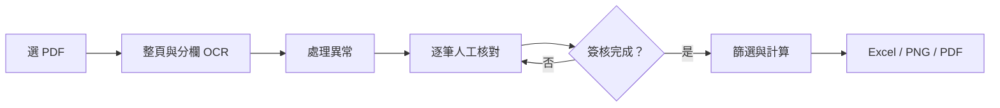

# CCIT 人工核對與分析工具

**從掃描報告，走到人工確認的數據、分析結果與圖表。**

[English](README.md) · [設計說明](docs/DESIGN.md) · [操作指南](docs/USAGE.md)

這是一個使用 Python 開發的 CCIT 資料處理工具，目的是減少人工轉錄儀器報告、整理數據及計算分析參數的時間。

程式可以從掃描 PDF 擷取數據，經過異常檢查與人工核對後，自動進行統計分析，並產生 Excel 報表及管制圖。

這個專案源自實際實驗室工作中遇到的問題。GitHub 展示內容使用模擬資料，目前仍屬開發中的個人作品，尚未經過正式 GMP 電腦化系統確效。

**目前狀態：** 尚非經驗證的正式生產系統，也不提供有身分驗證的電子簽章。


*展示圖為虛構資料，用來說明分析與作圖功能，不代表 OCR 準確率。*

## 我想解決的問題

儀器報告有時是 PDF 或掃描檔，需要人工將數據輸入 Excel。這不只花時間，也容易抄錯；直接改用 OCR，又可能把 `18` 認成 `19`，而兩者看起來都合理。

因此我把流程拆成 **資料擷取、人工核對、計算分析**，讓「程式跑完」與「資料已確認」有明確區別。

## 功能

- 視窗選 PDF，不用改檔名或手動搬程式。
- PDF 轉圖，保存 OCR 文字、位置與信心分數。
- 由表頭定位量測欄，分欄辨識，依整頁座標配對。
- 列出可辨識的異常，保存人工修正原因。
- 逐筆核對整份資料，包含預計排除的資料，再填姓名、日期與簽核。
- 完成確認後，計算參考統計、Warning Limit 與系統設定。
- 產生有顏色標記的 Excel、PNG 與 PDF 圖表。
- 不同 PDF 內容與 liquid／solid 型態分開保存結果。



## 安裝與執行

開發環境為 **Windows、Python 3.13**。其他平台與全新環境尚未驗證。程式進度與部分錯誤訊息目前為繁體中文；文件提供中英文，報表欄名為英文。

```powershell
python -m venv .venv
.\.venv\Scripts\python.exe -m pip install -r requirements.txt
.\.venv\Scripts\python.exe run_ccit_v3.py
```

在視窗選擇相容模板的 PDF，再輸入 `liquid` 或 `solid`。也可直接指定：

```powershell
.\.venv\Scripts\python.exe run_ccit_v3.py --pdf "C:\reports\test-report.pdf" --product-type liquid
```

選檔視窗使用 Tkinter。OCR 模型不包含在專案中，RapidOCR 首次執行可能需要下載模型。處理在本機執行，這個工具沒有主動上傳來源報告的功能。

## 不需要儀器 PDF 的模擬展示

```powershell
python -m pip install -r requirements-demo.txt
python demo.py
python -m unittest discover -s tests -v
```

模擬展示會建立固定的虛構資料，執行資料篩選、計算、Excel 與圖表輸出，存到 `demo_output/`。它**不測試 OCR，也不代表已有人簽核**，且不接受真實輸入檔案。

模擬資料共 51 筆：排除結尾 10 筆與 2 筆 QC，保留 39 筆，包括 30 筆一般樣品、3 筆陽性對照及 6 筆 Master。

## 人工核對如何運作

1. 依原圖處理前段異常 CSV。
2. 開啟該次資料夾的 `CCIT_final_review.xlsx`。
3. 在 **Data Review** 點 **Source Image** 對照原頁，每列確認後選 `Yes`。
4. 在 **Sign-off** 填核對人、日期及 `Approved`。
5. 儲存並關閉 Excel，再選同一份 PDF 與相同型態執行。

未確認的列會阻止主流程繼續。來源資料變更時，舊表保留，新表需要重新核對。最後核對表只做對照與簽核，不能直接改量測值；修正須回前段處理。若錯誤不在既有修正處理範圍，需要補上對應處理。

簽核是包含雜湊的本機紀錄，不能驗證填寫者身分，也不是不可竄改的稽核軌跡。正式操作應使用主入口；個別教學程式可獨立執行，並非所有執行方式都有相同關卡。

## 分析規則

| 項目 | 目前實作 |
|---|---|
| 排除順序 | 整份報告最後 10 筆，再排除 QC Check |
| 分類 | Master MC-Off、Master MC-On、STD／Positive SPL、一般 SPL |
| X 軸 | Master 為 0.1／0.5；SPL 為 1～N；陽性對照為 N+1 |
| 初篩 | 中位數 + 3 × 1.4826 × MAD 作為上側門檻 |
| 參考統計 | 未被初篩排除的一般樣品之平均與樣本 SD |
| 接近 WL | 平均 + 2 SD 到平均 + 3 SD，含兩端 |
| 超過 WL | 大於平均 + 3 SD |
| Reject Limit | 陽性平均與 WL 的中點，再依既定規則調整 |
| 系統設定 | liquid／solid 使用不同設定 |

從參考統計排除的樣品仍留在表與圖裡。儀器 Pass／Fail 和統計 WL 標記分開保存。這些是本專案採用的展示規則，不能當作所有 CCIT 方法的通用要求；詳細邊界見[設計說明](docs/DESIGN.md)。

## 程式分工

| 檔案 | 工作 |
|---|---|
| `run_ccit_v3.py` | 選檔、工作資料夾與流程串接 |
| `extract_pdf.py` | 轉圖與整頁 OCR |
| `column_ocr.py` | 分欄辨識、位置配對與異常處理 |
| `final_review.py` | 最後人工對照與簽核 |
| `prepare_v3_input.py` | 篩選、分類與編號 |
| `calculate_v3.py` | 統計、WL 與系統設定 |
| `format_report.py` | Excel 排版 |
| `plot_v3.py` | 圖表輸出 |
| `demo.py` | 虛構資料展示 |
| `tests/` | 規則與人工確認關卡測試 |

## 設計取捨與學習

第一版是針對固定列號修正已知錯誤；後來改為依頁面、欄位與位置定位，配合來源識別保留核對紀錄。這樣不必假設下一份 PDF 有相同樣本數，或在相同位置出錯。

重要的設計轉變是：把人工確認變成流程中的明確一步，而不是報表完成後才口頭提醒。整頁與分欄辨識可以交叉比對，但兩者也可能同時認錯。

這個專案展示 Python 檔案處理、OCR 資料結構、座標配對、資料驗證、pandas 分析、openpyxl 報表、matplotlib 作圖與 subprocess 串接。開發過程使用 AI 協助撰寫與除錯，並透過實際對照逐步調整領域規則與操作流程。

## 驗證與限制

- 模擬測試涵蓋樣本數變化、排除順序、分類優先權、無效數字、漏簽核與核對值被修改。
- 提供 GitHub Actions 測試設定；發布並實際執行前，不宣稱雲端 CI 已通過。
- 開發時曾對照本機模板；來源報告與其衍生資料不包含在此專案。
- 表頭、欄位順序、命名方式與像素容差仍有假設。旋轉掃描、audit trail 或額外時間欄可能需要調整。
- 高 OCR 分數與零配對異常，不等於每個數字正確。
- Excel 是計算結果，不是會隨儲存格修改而自動重算的完整模型。
- 簽核尚未完整綁定程式與規則版本，規則更新後需重新核對與驗證。

## 資料與發布

可公開範例僅使用虛構資料。`.gitignore` 排除來源報告、OCR、核對表、簽核、輸出與本機模型；發布前仍要檢查檔案清單，已提交的檔案不會因新增 ignore 自動消失。

目前沒有 EXE 或網站部署，也尚未指定開源授權；提供他人重用權利前需先選定授權。
